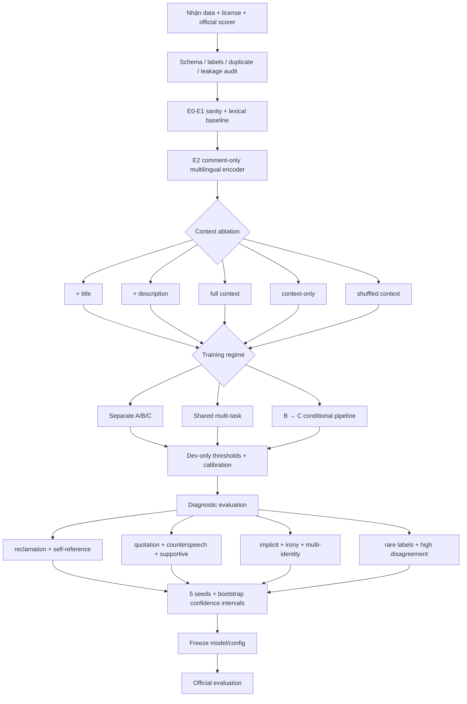
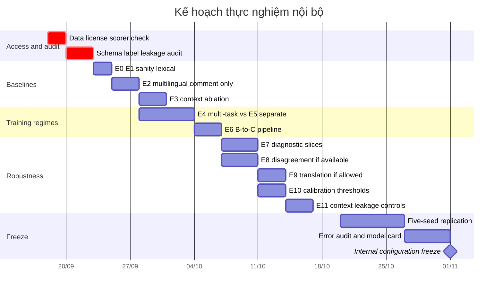

# Deep research về hate speech, LGBTQ+ content và kế hoạch thực nghiệm cho StereoQueerEval

## Tóm tắt điều hành

Đợt rà soát này ưu tiên các công trình **2024–2026**, sau đó giữ lại một số nghiên cứu trước đó có ảnh hưởng trực tiếp tới cách đánh giá. Kết luận lớn nhất là: với hate speech nhắm LGBTQ+, **“có slur” và “có hate” không phải cùng một biến**. MultiPRIDE 2026 biến chính sự khác biệt giữa *reclamatory* và *non-reclamatory* usage thành một shared task đa ngôn ngữ; QueerReclaimLex cho thấy các hệ thống harm detection đặc biệt dễ xử lý sai những câu có dấu hiệu do chính người thuộc nhóm bị slur nhắm tới viết; còn IYKYK 2026 cho thấy ngay cả annotator nội nhóm cũng có bất đồng đáng kể khi speaker identity và intent không rõ. citeturn17search3turn16view3turn16view0

Điều này làm thay đổi cách nên đánh giá StereoQueerEval: ngoài leaderboard score, cần một **diagnostic suite riêng cho reclamation, self-reference, quotation, counterspeech, supportive mention và identity mention without attack**. Đặc biệt nên theo dõi false-positive rate trên các slice này, vì một model có Macro-F1 tốt vẫn có thể over-moderate chính diễn ngôn LGBTQ+ mà benchmark muốn phân biệt. Đây là suy luận thực nghiệm trực tiếp từ MultiPRIDE, QueerReclaimLex và IYKYK. citeturn18view1turn16view3turn16view2

Bằng chứng mới cũng **không ủng hộ việc mặc định multi-task tốt hơn separate training**. HODIAT 2025, một dataset homotransphobic hate rất gần bài toán này, giữ annotation rời của ba annotator LGBTQIA+ và đánh giá hate, aggressiveness, target; paper báo cáo joint treatment của các chiều nhìn chung kém ổn định hơn xử lý riêng. Ngược lại, ViHateT5 2024 cho thấy một unified text-to-text model có thể hoạt động rất tốt trên ba benchmark HSD tiếng Việt khác loại. Hai kết quả này không mâu thuẫn: chúng nói rằng *sharing representations là một hypothesis phải kiểm chứng*, không phải một mặc định kiến trúc. citeturn20view1turn6view0turn22view0turn22view3

Context cũng cần được kiểm soát bằng ablation. AIWizards tại MultiPRIDE dùng tweet + biography cùng một encoder phụ weakly supervised về affiliation signal; dual encoder của họ **không vượt một BERT baseline mạnh** trên development set: Italian khoảng 0.88 so với 0.90, Spanish khoảng 0.64 so với 0.67, với khác biệt không có ý nghĩa thống kê trong kiểm định của nhóm tác giả. Vì vậy, với title/description của StereoQueerEval, nên chạy `comment-only`, `+title`, `+description`, `full context`, cộng thêm hai negative controls là `context-only` và `shuffled context`. citeturn18view1

Về disagreement, bằng chứng 2024–2026 khá nhất quán rằng đây không đơn giản là annotation noise. HODIAT có Fleiss’ κ khoảng 0.71–0.74 cho target nhưng chỉ khoảng 0.33–0.51 cho aggressiveness; HateWiC dự đoán cả majority và individual annotator labels và thấy annotator demographics trở nên quan trọng hơn ở các trường hợp subjectivity cao; corpus perspectivist 2025 với năm annotation mỗi mẫu cho thấy disagreement thường tập trung ở edge cases và context-dependent terms. citeturn20view1turn25view1turn24search1

Cuối cùng, **translate-to-English không nên là pipeline mặc định**. Nghiên cứu LGBTQIA+ multilingual năm 2024 thấy fine-tuning cải thiện tương đối nhất quán trong khi machine translation có hiệu quả lẫn lộn; preprint anti-LGBTQ bias rất mới, đăng cuối tháng 8/2026, lại cho thấy stereotype benchmark dịch và stereotype lấy trực tiếp từ queer community có thể tạo ra tín hiệu khác nhau. Đây là lý do để lấy native multilingual modeling làm baseline chính, còn translation chỉ là ablation nếu rule cho phép. citeturn14search1turn15view0

**Các giả định khi lập kế hoạch:** quyền truy cập dataset cuối cùng, schema C và official scorer của StereoQueerEval vẫn được coi là chưa chốt trong workspace; ngân sách cơ sở được giả định là **1 GPU khoảng 24 GB VRAM, 32–64 GB RAM**; external datasets, machine translation, synthetic augmentation và LLM APIs chỉ được dùng nếu organizer cho phép. File gốc đã xác định rõ nhiều chi tiết Task 8 vẫn cần chờ tài liệu/scorer chính thức, nên phần nghiên cứu mới không tự biến các giả định này thành fact của cuộc thi. fileciteturn0file0

## Bản đồ tài liệu và dataset

Bảng dưới đây là shortlist mình đánh giá hữu ích nhất cho quyết định thiết kế. Những nguồn 2026 được ưu tiên; HateCheck được giữ lại vì nó là tiền lệ đặc biệt quan trọng cho functional evaluation.

| Công trình | Năm / venue | Dataset | Labels và annotation protocol | Metrics / setup | Kết quả chính | Code / data | Nguồn |
|---|---|---|---|---|---|---|---|
| **MultiPRIDE: Overview of Multilingual Automatic Detection of Slur Reclamation** | 2026, EVALITA | Tweet EN/IT/ES chứa term liên quan LGBTQ+; text-only và text+profile context | Binary `reclamatory` / `non-reclamatory`; track contextual cho phép metadata như biography | Accuracy, Precision, Recall, F1; ranking theo F1 | Reclamation được tách thành benchmark độc lập, trực tiếp phủ nhận heuristic “slur ⇒ hate” | Data do organizer quản lý | [ACL](https://aclanthology.org/2026.evalita-1.18/) · [Task site](https://multipride-evalita.github.io/) citeturn17search3turn28search5 |
| **AIWizards at MultiPRIDE** | 2026, EVALITA / arXiv | Italian 1,086; Spanish 876 trong setup của paper; tweet + bio | Task label + weakly supervised proxy affiliation từ DeepSeek-V3.2; authors nhấn mạnh proxy không phải ground-truth protected identity | Macro-F1, 5 seeds; BERT baseline vs gated dual encoder | Baseline/dual dev: IT ≈ .90/.88, ES ≈ .67/.64; không cải thiện có ý nghĩa thống kê | Code public | [arXiv](https://arxiv.org/abs/2602.12818) · [GitHub](https://github.com/LucaTedeschini/multipride) citeturn18view1 |
| **Continual Learning with Multilingual Foundation Model** | 2026, arXiv | MultiPRIDE EN/ES/IT | Binary reclamation; back-translation, undersampling, continued MLM | XLM-R; Macro-F1; per-language threshold | Threshold riêng theo language được báo cáo cải thiện khoảng **2–5 điểm F1 tuyệt đối** mà không retrain | Code public | [arXiv](https://arxiv.org/abs/2605.13415) · [GitHub](https://github.com/rbg-research/MultiPRIDE-Evalita-2026) citeturn26academia45 |
| **IYKYK (But AI Doesn't)** | 2026, arXiv preprint | Online slur corpus cho LGBTQIA+, Black và women communities | In-group annotators đánh giá có nên flag hate + contextual features; thêm semi-structured interviews | IAA + alignment với Perspective API | IAA thấp; lived experience ảnh hưởng interpretation; Perspective API alignment kém; derogatory use và self-targeting liên hệ với hate judgments | Public paper; dataset release không được xác nhận từ trang arXiv đã rà soát | [arXiv](https://arxiv.org/abs/2604.16654) citeturn16view0turn16view2 |
| **Evaluating and Mitigating Anti-LGBTQ Biases in German and Multilingual LMs** | 2026, arXiv preprint | Translated WinoQueer + 387 community-sourced CrowS-style pairs; 103 queer participants | Pairwise stereotype/anti-stereotype preference từ dữ liệu dịch và trải nghiệm cộng đồng | Binary/soft bias scores; 8 model families | Community-derived và translated benchmarks không cho tín hiệu hoàn toàn tương đương; mitigation không đồng đều theo model/identity | Paper báo cáo code/data repo | [arXiv](https://arxiv.org/abs/2608.30884) citeturn15view0 |
| **SEAHateCheck** | 2026, TALLIP accepted / arXiv | Functional tests cho Indonesian, Tagalog, Thai, **Vietnamese** | LLM-assisted test generation, sau đó local experts validate | Functional diagnostic evaluation | Slang đặc biệt khó; model còn yếu ở implicit hate và counterspeech | Paper arXiv; repo public chưa xác nhận trong đợt rà soát | [arXiv](https://arxiv.org/abs/2603.16070) citeturn16view5turn16view6 |
| **Current Practices and Recommendations for Working with Stereotypes in NLP** | 2026, NLPerspectives | Survey annotation schemes + re-annotation case study trên QUEEREOTYPES | So sánh nhiều cách operationalize stereotype về clarity, overlap, usefulness | Annotation analysis | Cho thấy khái niệm/operationalization của stereotype rất không đồng nhất giữa nghiên cứu | ACL open access | [ACL](https://aclanthology.org/2026.nlperspectives-1.11/) citeturn17search1 |
| **HODIAT** | 2025, WOAH | 6,000 Italian tweets từ HODI | Hate + `GROUP/INDIVIDUAL` + `AGGRESSIVE/NON-AGGRESSIVE`; 3 annotator đều là thành viên LGBTQIA+; release disaggregated annotations | Weighted Macro-F1; zero/few/fine-tune với GPT-4o-mini, Llama, Qwen, XLM-T, HATE-ITA, ModernBERT… | Target κ ≈ .71–.74, aggression κ ≈ .33–.51; XLM-T FT ≈ .82/.96/.85 cho hate/aggression/target; joint setup nhìn chung kém ổn định | Guidelines/data qua HODI repo | [ACL](https://aclanthology.org/2025.woah-1.11/) · [GitHub](https://github.com/HODI-EVALITA/HODI_2023) citeturn20view1turn6view0 |
| **A Disaggregated Dataset on English Offensiveness Containing Spans** | 2025, NLPerspectives | 1,983 Jigsaw posts | 5 annotations/mẫu; toxicity + inappropriate-language spans + target spans | Agreement + transformer classification/error analysis | Disagreement xuất hiện nhiều ở edge cases và context-dependent words; aggregated training có thể giảm false negatives bằng cách nhạy hơn với minority-toxic opinions | Annotation mới CC BY 4.0 | [ACL](https://aclanthology.org/2025.nlperspectives-1.1/) citeturn24search1 |
| **QUEEREOTYPES** | 2024, LREC-COLING | Italian Facebook + Twitter LGBTQIA+ discourse | FB: hate, stereotype, aggression, offensiveness, irony; Twitter: stereotype + stance; phát triển cùng LGBTQ+ activists | IAA + 5-fold CV; AlBERTo/mBERT | Cho thấy stereotype và hate là các chiều riêng; FB gold subset có imbalance mạnh, với khoảng 7.8% hate và 5.3% stereotype | Chia sẻ theo điều kiện/yêu cầu của paper | [ACL](https://aclanthology.org/2024.lrec-main.1176/) citeturn28search0turn6view2turn6view3 |
| **Gender-Queer Dialect Bias / QueerReclaimLex** | 2024, arXiv | 109 curated templates về non-derogatory LGBTQ+ slur usage | Gender-queer annotators đánh giá potential harm dưới speaker-identity contexts khác nhau | 5 off-the-shelf LMs + CoT; F1 | Điều kiện có dấu hiệu tác giả thuộc target group là khó nhất: **F1 ≤ .24** ở các LLM được thử | Paper/license trên arXiv | [arXiv](https://arxiv.org/abs/2406.00020) citeturn16view3turn16view4 |
| **Hateful Word in Context Classification — HateWiC** | 2024, EMNLP | ~4,000 word-in-context instances | 3 annotators/mẫu; majority + individual labels; dictionary sense và annotator demographics | Context/sense models | Definition giúp tổng thể nhưng không giải quyết tốt các context có hateful connotation biến đổi; demographics hữu ích hơn cho subjective cases | ACL material | [ACL](https://aclanthology.org/2024.emnlp-main.10/) citeturn25view1 |
| **“Is Hate Lost in Translation?”** | 2024, ALTA | LGBTQIA+ HSD: English, Italian, Chinese, English–Tamil code-mix | So sánh zero-shot, fine-tuning và translation trên multilingual resources | Classification metrics theo language/setup | Fine-tuning cải thiện nhất quán hơn; translation cho hiệu quả mixed | ACL paper | [ACL](https://aclanthology.org/2024.alta-1.11/) citeturn14search1 |
| **ViHateT5** | 2024, Findings ACL | VOZ-HSD 10.8M auto-labeled comments; ViHSD, ViCTSD, ViHOS | Unified text-to-text prefixes cho HSD, toxicity và hate-span detection | Acc, Weighted-F1, Macro-F1 | Average Macro-F1 **.7556**, so với ViSoBERT .7507 trong reproduction của paper; chứng minh unified formulation có thể hiệu quả | Dataset, checkpoints, unified model và code public | [ACL](https://aclanthology.org/2024.findings-acl.355/) · [GitHub](https://github.com/tarudesu/ViHateT5) citeturn22view0turn22view2turn22view4 |
| **ViTHSD** | 2024/2025, Journal of Computational Social Science / arXiv | 10K Vietnamese social-media comments | 5 targets; mỗi target có `clean/offensive/hate`; human annotation; Cohen’s κ = .45 | Target-aware neural baseline + pretrained LM | Tiền lệ trực tiếp cho structured target×severity prediction bằng tiếng Việt; agreement chỉ ở mức vừa | Paper arXiv | [arXiv](https://arxiv.org/abs/2404.19252) citeturn16view7 |
| **HateCheck** | 2021, ACL-IJCNLP | Functional test suite thay vì natural test corpus | 29 model functionalities; crafted cases + structured validation | Performance theo functionality | Chỉ ra rằng aggregate held-out F1 khó xác định failure mode cụ thể | Public research resource | [ACL](https://aclanthology.org/2021.acl-long.4/) citeturn24search12 |

Với nguồn tiếng Việt, ngoài ViHateT5, ViTHSD và SEAHateCheck, đáng giữ hai nguồn làm **cultural/context references**. Báo cáo tiếng Việt của iSEE năm 2025 về Internet, mạng xã hội, tin giả và nội dung thù ghét với thanh thiếu niên LGBT sử dụng cả định lượng và định tính, với 780 bản ghi khảo sát hợp lệ. citeturn27view0 Nghiên cứu của Nguyen & Clancy dùng corpus khoảng 390.000 từ từ báo điện tử Việt Nam và quan sát cả các liên tưởng tiêu cực lẫn xu hướng biểu đạt bao trùm hơn; dataset có thể xin tác giả theo yêu cầu. citeturn27view1 Hai nguồn này thích hợp để thiết kế taxonomy và review linguistic phenomena, **không phải để biến thành gold labels cho Task 8**.

## Bằng chứng quyết định thiết kế

### Reclamation và false positives quan trọng hơn một lexicon slur lớn

MultiPRIDE định nghĩa bài toán chính xác ở nơi lexical heuristics thất bại: một LGBTQ+-related term có thể mang ý nghĩa derogatory hoặc in-group/reclamatory tùy context. AIWizards còn mô tả dữ liệu có tweet ngắn, mỉa mai, elliptical, quoted hay re-contextualized, tức nhiều trường hợp surface form không đủ quyết định label. citeturn18view1

QueerReclaimLex bổ sung bằng chứng fairness: mô hình harm detection có xu hướng overflag ở điều kiện tín hiệu tác giả thuộc chính target group của slur. IYKYK bổ sung góc annotation: *self-targeting* không tự động có một interpretation duy nhất; community members có thể bất đồng vì lived experience và lịch sử cá nhân khác nhau. citeturn16view3turn16view0

Vì vậy error taxonomy nên tối thiểu có các slice sau: `reclamation`, `self-reference`, `quotation`, `counterspeech`, `supportive mention`, `identity mention without attack`, `implicit stereotype`, `irony/sarcasm`, `multi-identity`, và `individual-vs-group`. Đây nên là **diagnostic tags trên dev**, không phải tự ý tạo label thay organizer.

### Disagreement phải được giữ càng lâu càng tốt

HODIAT là ví dụ đặc biệt hữu ích: cùng ba annotator, target classification có agreement cao hơn rất rõ so với aggressiveness. Nghĩa là một scalar “dataset quality” không phản ánh được mức subjectivity của từng chiều annotation. citeturn20view1

Biểu đồ tái hiện số Fleiss’ κ HODIAT công bố: target tăng từ khoảng .707 lên .739 qua ba batch, trong khi aggressiveness dao động khoảng .335–.511. citeturn20view1 Cùng với HateWiC và dataset disaggregated 2025, điều này ủng hộ việc lưu `label_distribution`, `entropy`, `majority_label` và `adjudicated_label` riêng nếu organizer cung cấp annotations theo annotator. citeturn25view1turn24search1

Một kết quả liên quan khác từ WOAH 2025: Caselli & Plaza-del-Arco dùng entropy của annotator disagreement để chọn few-shot examples cho Llama/Qwen; các shot có ambiguity trung bình thường hữu ích, nhưng ICL nhìn chung vẫn thường kém fine-tuned encoders trong thiết lập của họ. Vì vậy disagreement có thể dùng để chọn/evaluate difficult cases, nhưng không phải lý do để mặc định chuyển toàn bộ pipeline sang prompting. citeturn24search0

### Multi-task và separate phải là một controlled comparison

HODIAT là bằng chứng gần nhất cho phía **separate**: joint handling hate/aggressiveness/target không cho lợi ích ổn định và nhìn chung có xu hướng yếu hơn các setup riêng. citeturn6view0

ViHateT5 là counterexample hữu ích nhưng phải hiểu đúng: nó không chứng minh một shared multi-head classifier sẽ thắng trên các nhãn A/B/C cùng dataset. Nó dùng **text-to-text task prefixes** để thống nhất ba benchmark/tasks khác nhau, được hỗ trợ bởi domain-specific pretraining trên 10.8 triệu comment VOZ-HSD. Do đó kết quả của nó chỉ chứng minh rằng task sharing *có thể* hiệu quả khi formulation và representation phù hợp. citeturn22view2turn22view0

Kết luận thực nghiệm nên là:

> `Separate A/B/C` là control bắt buộc; `shared multi-task A+B+C` là treatment. Quyết định dựa trên **điểm từng task và từng rare label**, không dựa trên một average score duy nhất.

### Context cần cả ablation lẫn negative controls

AIWizards là một cảnh báo tốt rằng thêm contextual encoder và weak supervision có thể tạo architecture hợp lý nhưng vẫn không thắng một baseline đơn giản. citeturn18view1 Vì vậy với StereoQueerEval, thứ tự đúng không phải `full context → tune model`, mà là:

`comment only → comment+title → comment+description → comment+title+description → context only → shuffled same-language context`.

Nếu `context-only` đã mạnh bất thường, cần điều tra topic/source leakage. Nếu shuffled context gần bằng context đúng, model có thể đang dùng distribution/topic shortcut hơn là contextual interpretation. Đây là các negative controls đề xuất, dựa trên vấn đề context-dependence được quan sát trong MultiPRIDE và HateWiC. citeturn18view1turn25view1

Một giới hạn quan trọng: MultiPRIDE cho phép author biography ở contextual track, nhưng điều đó **không có nghĩa** StereoQueerEval được phép crawl hoặc suy protected identity của author. Chỉ nên dùng các field mà Task 8 chính thức cung cấp/cho phép. AIWizards cũng tự lưu ý các vấn đề privacy, consent và stereotyping của automatic user profiling. citeturn18view1

## Ma trận thí nghiệm đề xuất

Ma trận dưới đây giả định một máy có 1 GPU khoảng 24 GB. `XLM-R-base` là default hợp lý cho vòng đầu vì kế hoạch Task 8 hiện có nhiều ngôn ngữ; model lớn/chuyên ngôn ngữ chỉ nên chạy sau khi baseline và scorer ổn định. Các external resources trong bảng chỉ được kích hoạt nếu rule cho phép.

| ID | Hypothesis | Dataset | Models | Training regime | Metrics | Expected outcome / tiêu chí quyết định | Timeline | Resources |
|---|---|---|---|---|---|---|---|---|
| **E0** | Schema/scorer sai có thể phá mọi experiment sau | Official train/dev + tiny manually checked subset | Random/majority | None | Official scorer, format tests | Chỉ đi tiếp khi scorer reproducible và prediction round-trip đúng | Ngày đầu | CPU |
| **E1** | Dataset có thể chứa lexical shortcuts mạnh | Official train/dev theo language | TF-IDF word+char + Logistic Regression | Separate A/B/C | Macro-F1, class F1 | Tạo floor và shortcut detector | Ngày 1–2 | CPU |
| **E2** | Native multilingual encoder vượt lexical baseline | Same | XLM-R-base, comment only | Separate models | Macro-F1, per-language/class F1, 3 seeds | Baseline neural chính | Ngày 2–4 | 1×24 GB |
| **E3** | Context giúp implicit harm nhưng có thể leak | Same | XLM-R-base | comment; +title; +description; full; context-only | Macro-F1 + implicit/reclamation slices | Chỉ giữ context khi gain lặp lại và negative control hợp lý | Ngày 4–6 | 1×24 GB |
| **E4** | Shared representations tạo transfer A↔B↔C | Same | Shared XLM-R + task heads | Joint multi-task | A/B/C F1, per-identity F1 | So trực tiếp E5; không chấp nhận gain A/B để che drop C | Tuần 2 | 1×24–48 GB |
| **E5** | Different label semantics khiến separate training an toàn hơn | Same | Cùng backbone E4 | Fully separate | Cùng metrics E4 | Control bắt buộc cho E4; HODIAT tạo prior cho hypothesis này citeturn6view0 | Tuần 2 | 1×24 GB |
| **E6** | B→C conditioning giảm identity predictions trên non-hate | Same | Best B + C | Hard gate vs soft probability conditioning | B F1; C macro/micro/sample F1 | Chỉ giữ nếu C tăng mà không khuếch đại B false negatives | Tuần 2 | 1×24 GB |
| **E7** | Aggregate score đang che over-moderation queer speech | Dev + manually tagged diagnostics | Best E2–E6 | Inference only trước tiên | FPR trên reclamation/self-ref/quotation/counterspeech/supportive | Giảm FPR mà không làm mất recall direct hate; lấy cảm hứng MultiPRIDE/QueerReclaimLex citeturn16view3turn17search3 | Tuần 2–3 | Inference |
| **E8** | Soft labels cải thiện calibration ở subjective examples | Raw annotator labels nếu được cấp | Best encoder | Majority CE vs soft-target KL/BCE | Official F1, Brier/ECE, entropy buckets | Chỉ chạy trên annotations thật, không dùng LLM tạo “fake disagreement” | Tuần 3 | 1×24 GB |
| **E9** | Native multilingual tốt/ổn định hơn translate-to-English | Dev từng language | XLM-R native vs translated pipeline | Separate | Macro-F1 + slang/implicit/reclamation slices | Translation chỉ giữ nếu gain rõ theo từng language; literature cho hiệu ứng mixed citeturn14search1 | Tuần 3 | GPU + MT budget |
| **E10** | Threshold global làm hại rare labels/languages | Dev only | Best model C | Per-label/per-language threshold | Macro/Micro-F1, PR-AUC, calibration | Freeze threshold trước test; MultiPRIDE 2026 báo cáo gain 2–5 F1 từ language-specific thresholding citeturn26academia45 | Tuần 3 | CPU |
| **E11** | Video title/description có thể tạo source/topic shortcut | Dev; group/cluster theo video khi có ID | Best contextual system | Full context vs shuffled context | ΔF1, prediction flip rate | Nếu shuffled/context-only vẫn mạnh, audit leakage trước tuning | Tuần 3 | Inference |
| **E12** | Functional test lộ lỗi không thấy trong natural test set | SEAHateCheck + optional community-reviewed Vietnamese LGBTQ mini-suite | Best multilingual model | Zero-shot diagnostic | Accuracy/F1 theo functionality | Chỉ là robustness report, không nhập vào official score; SEAHateCheck cho thấy slang/implicit/counterspeech khó citeturn16view5 | Sau baseline | Inference |
| **E13** | Một leaderboard gain nhỏ có thể chỉ do seed | Shortlist 2–3 systems | Best configs | 5 seeds | mean±std, bootstrap CI, paired test | Chốt system dựa trên effect ổn định, không single lucky run | Trước freeze | 1×24–48 GB |

Với C, trước khi official scorer được công bố rõ, metric set tạm thời nên gồm **label Macro-F1, Micro-F1, sample-F1, Hamming loss, exact match và per-label P/R/F1**. Với label hiếm, thêm PR-AUC và support count; với probability outputs, thêm Brier score/ECE. Những metric này nên được coi là diagnostic chứ không được gọi là “official C score” cho đến khi organizer chốt scorer.

## Quy trình và timeline

Workflow dưới đây ưu tiên kiểm tra data/scorer/leakage trước rồi mới tăng model complexity. Hướng này phù hợp với bài học từ HateCheck về giá trị của functional diagnosis, từ HODIAT về label-specific difficulty, và từ MultiPRIDE về context/reclamation. citeturn24search12turn20view1turn18view1

Timeline dưới đây là **lịch nội bộ đề xuất**, không phải deadline mới của SemEval. Nó giả định checkpoint truy cập dữ liệu bắt đầu từ 18/09/2026; nếu dataset/scorer chưa có thì toàn bộ phần training dịch lùi tương ứng.

## Checklist, research gaps và file đã cập nhật

Một submission/report nên được coi là chưa hoàn thiện nếu mới có một bảng Macro-F1 tổng. HateCheck đã chỉ ra tại sao aggregate test-set performance không đủ để chẩn đoán failure modes; SEAHateCheck mới hơn tiếp tục cho thấy functional testing phát hiện rõ vấn đề slang, implicit hate và counterspeech ở low-resource languages. citeturn24search12turn16view5

Checklist mình đã đưa vào file yêu cầu: dùng cùng split/preprocessing khi so model; tối thiểu 3 seeds trong exploration và 5 seeds cho shortlist; luôn báo per-language/per-class/per-label support; chỉ tune threshold trên dev; chạy `context-only` và `shuffled-context`; báo FPR riêng cho reclamation/self-reference/quotation/counterspeech/supportive; báo recall cho implicit harm; giữ raw annotator labels nếu có; kiểm tra duplicate/group-by-video leakage; dùng confidence intervals/paired tests cho gain nhỏ; và lưu data hash, scorer hash, model/tokenizer revision, seed, environment và submission hash.

Khoảng trống lớn nhất hiện nay là **không có một paper đơn lẻ nào giải quyết đúng cấu trúc StereoQueerEval**: MultiPRIDE nghiên cứu reclamation nhưng context là author profile; HODIAT có individual/group nhưng chưa có identity multilabel giống C; QUEEREOTYPES tách stereotype/hate nhưng chỉ Italian và schema khác; disagreement papers chưa đưa ra một universal gold aggregation scheme; literature mới nhất cũng tập trung nhiều hơn vào English/Italian/Spanish so với Dutch và đặc biệt Farsi. citeturn18view1turn20view1turn28search0turn24search1

Điều đó tạo ra một research contribution khá rõ cho team: **so sánh separate vs joint A/B/C dưới cùng backbone; đo causal value của title/description qua controlled context ablations; và báo over-moderation qua reclamation/supportive false-positive slices**. Đây có khả năng tạo ra insight khoa học mạnh hơn việc chỉ thay XLM-R bằng một model lớn hơn.

Bản Markdown đã được cập nhật bằng cách **thay thế/mở rộng phần “Deep research”**, thêm bảng literature 2024–2026, phần Việt Nam, phân tích reclamation/context/disagreement/multi-task, ma trận E0–E13, hai Mermaid diagrams, evaluation checklist, assumptions và các reference mới; các phần lịch sử Task 8 trước đó vẫn được giữ lại để có thể truy vết thay đổi.

**[Tải file Markdown đã cập nhật](sandbox:/mnt/data/task8_context_deep_research_2026-09-17.md)**

**[Tải biểu đồ HODIAT annotator agreement](sandbox:/mnt/data/task8_hodiat_iaa.png)**